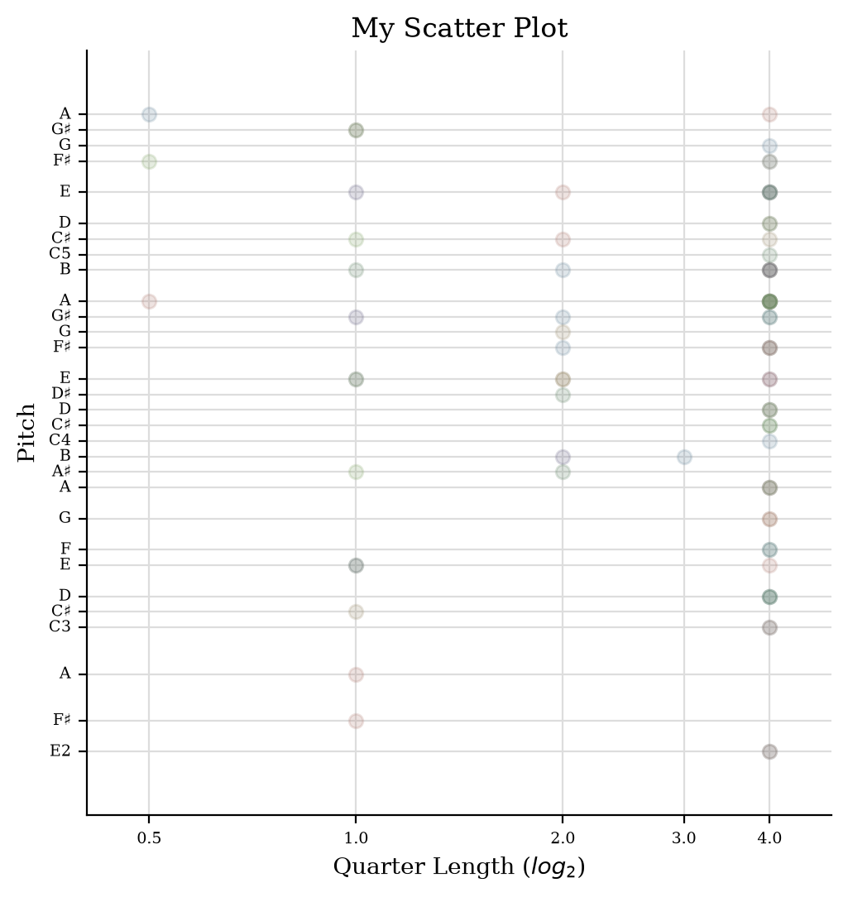
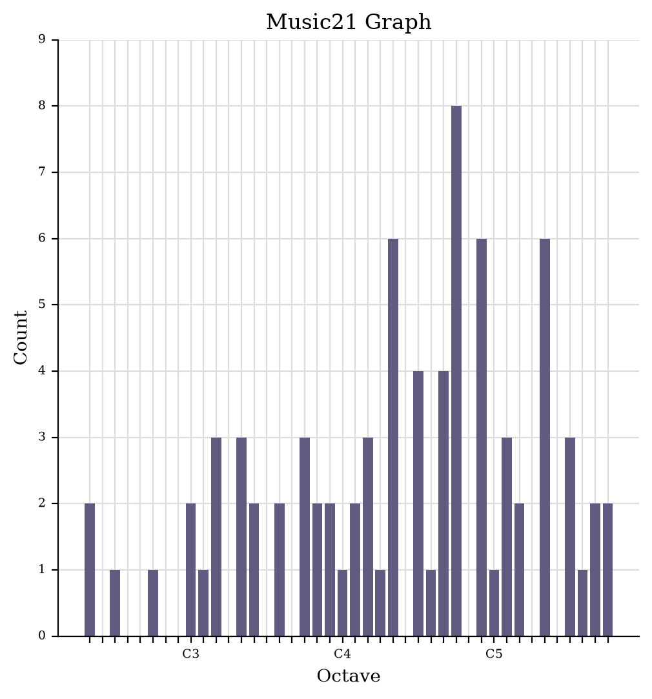

# Week 4

#### Task 1:  
<ins>jSymbolic Analysis</ins>
1. [Excel](jSymbolic - Because I Love You 1.csv)
2. [ARFF](jSymbolic - Because I Love You 1.arff)
3. [Code 1](jSymbolic - Because I Love You 1.xml)
4. [Code 2](jSymbolic - Because I Love You 2.csv)

Based on the data produced by jSymbolic, I was able to identify that there are 30 notes being played throughout the score (number_of_pitches) and that the score is in the Key A (most_common_pitch_class). These are just some information that as a performer, I would need to know like the key of the piece but also good to know how many notes are being played. This way, I can compare it to other pieces that I play and also judge the level of difficulty accordingly. However, this is not an accurate number as the score is incomplete. Producing this information without the caveat that the Musicxml document used in an incomplete encoding of the song will ultimately change the way that the song is being analysed. This shows that beyond the numbers, context is required as well. Another point of contention is that the analysis is done in numbers. ALthough it is supposed to translate to the context of music specifically recorded in the Western Music Notation, I think that it is still dependent on the data user's musical background. Information would otherwise be deemed as just numbers as they have no real meaning until you apply it to music. 

#### Task 2:  
<ins>Scatter plot</ins>

  

  
<ins>Pitch histogram</ins>

  

[← Back to home](./)
