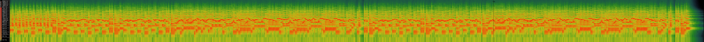
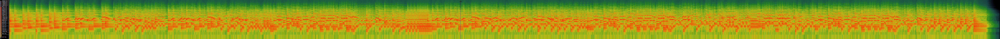

# Week 8

#### Task 1:  

| Song 1  |  |
| ------------- | ------------- |
| Title | "눈,코,입" (Eyes, Nose, Lips) |
| Artist | Taeyang |
| Composer | Teddy Park, Rebecca Johnson, DEE.P |
| Copyright information | © / ℗ |
| Genre | R&B |
| Source | Musescore, YG Entertainment |
| File/ Audio format | WAV audio |
| Number of channels | 2 |
| Sample rate | 44.100kHz |
| Bits per second | 2,822,400 |
| Duration | 3 min 48 sec |

| Song 2  | |
| ------------- | ------------- |
| Title | "첫눈" (The First Snow) |
| Artist | EXO |
| Composer | Kenzie, Kim Jeong-bae |
| Copyright information | © |
| Genre | Korean ballad, R&B |
| Source | Musescore, SM Entertainment |
| File/ Audio format | WAV audio |
| Number of channels | 2 |
| Sample rate | 44.100kHz |
| Bits per second | 2,822,400 |
| Duration | 2 min 23 sec |

| Song 3  | |
| ------------- | ------------- |
| Title | "멈춰줘" (Hold me back) |
| Artist | Heize |
| Composer | Nam Hye-seung |
| Copyright information | © / ℗ |
| Genre | Korean ballad |
| Source | Musescore, SORI NARLY |
| File/ Audio format | WAV audio |
| Number of channels | 2 |
| Sample rate | 44.100kHz |
| Bits per second | 2,822,400 |
| Duration | 3 min 39 sec |

1. All the WAV files were generated from the readily available Musescore transciptions of the songs online. These might not be the full song and many variations exist online which could sound similar but are not the original recording that is only available through a paywall (spotify) that might not be available for download in WAV format. In doing so, WAV file can be formated with the sample rate and bits per second. Therefore the 3 WAV files have the exact same sample rate and bits per second which are the default when exporting from Musescore.
2. Background information was sourced from many different places like Wikipedia and Spotify credits. Ideally, these metadata would be available from a credible source like the production label but not all songs have these readily available. Wikipedia is not always accurate as it allows members of the public to change the information of the songs and that would lead to a misrepresentation in my metadata. Another reliable source could be Melon music, a Korean music app that is available in Korea and presents in korean. As a non-korean, I find it difficult to access the website on top of reading the information despite it being able to translate into English. Some key information could be lost in translation.

#### Task 2:  
> Click picture to see details

<ins>Song 1: "눈,코,입" (Eyes, Nose, Lips)</ins>

<audio controls src="audio/TAEYANG.mp3"></audio>

  
  

<ins>Song 2: "첫눈" (The First Snow)</ins>

  
  

<ins>Song 3: "멈춰줘" (Hold me back)</ins>

  
  

<ins>Reflection</ins>  
My choice of songs were based on Korean artistes, with a focus on the genre of R&B and Korean Ballad. My initial interactions with these songs are through Spotify, and to dowload the audio recording for these songs on the platform, it is nearly impossible without a form of payment. Even with Musescore, I gave up many song choices because I had to pay for the WAV file or that it is not available for download. My observation across the various weeks do indicate that this is a pattern. The monetisation of songs lead to a struggle with encoding and transcribing. Of course, this makes an artiste's work valuable and gives a musician a livelihood. This goes to show that the system is might not be built in consideration of future archival purposes. The caveat here is that these are more recent music pieces,which could indicate that the system has evolved to prioritise monetisation than the continuation and appreciation of music. However, technological improvements have also aid the production and recording of songs from individuals that might not have been able to access these tools without a large monetary investment into music training. 

[← Back to home](./)
